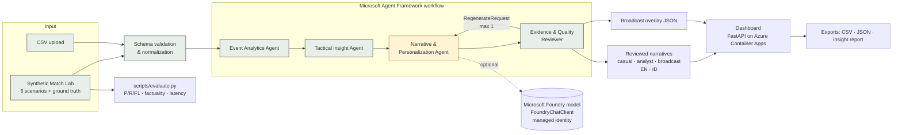

# Architecture

Green nodes are deterministic; the amber node is the only place a language model is involved, and its output is always verified downstream.

## Separation of deterministic and probabilistic work

| Layer | Source of truth? | Module |
|---|---|---|
| Event generation, validation, normalization | yes | `synth.py`, `schema.py` |
| Metrics, windows, momentum, fast breaks, match states | yes | `analytics.py` |
| Match-shift detection, evidence retrieval | yes | `shifts.py` |
| Evidence registry (id → value) | yes | `narrative.build_evidence` |
| Narrative wording | no — must cite evidence | `narrative.py` (templates), `writer.py` (Foundry) |
| Claim verification | gatekeeper | `reviewer.py` |

## Request lifecycle (`POST /api/analyze`)

1. API generates the match for `(scenario, seed)` (or validates uploaded rows).
2. `run_pipeline` builds a fresh Agent Framework workflow and runs it with a 90 s timeout.
3. Each agent appends a trace record; Agent Framework `executor_invoked/completed` events are captured too.
4. The reviewer yields the final result: analytics, moments, evidence registry, evidence events, narratives, review reports, review history and trace.
5. For synthetic scenarios the API adds the ground truth and a detection check.

## Failure handling

| Failure | Behaviour |
|---|---|
| Invalid rows (bad timestamps, coordinates, types) | Dropped with reasons; analysis continues |
| Wrong number of teams / teams mismatch / no events | Error result with validation report; UI explains how to fix |
| Gaps in events | Warning; empty windows handled |
| Model unavailable, error, timeout, invalid JSON | Template narrative used, writer error shown |
| Model invents numbers or causes | Reviewer rejects → one regeneration with feedback → template fallback |
| Unexpected exception | API returns an error object; service stays up |
